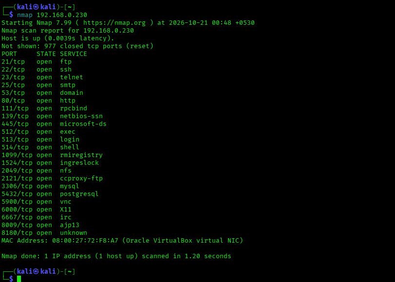
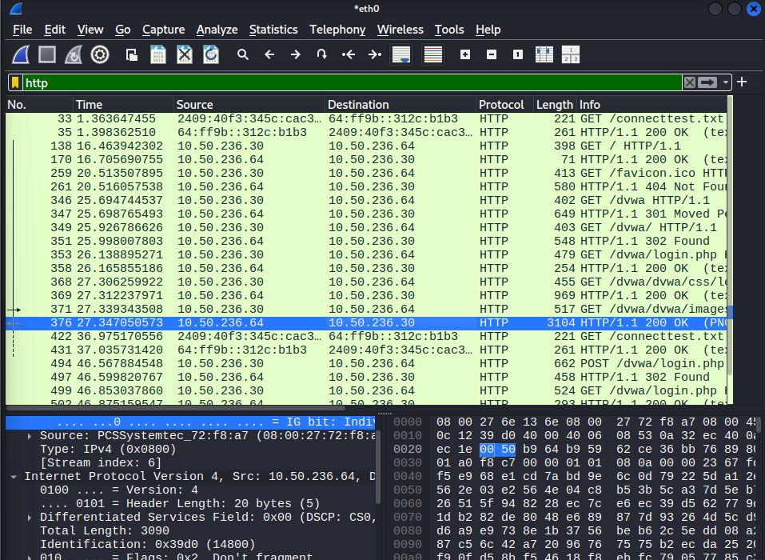
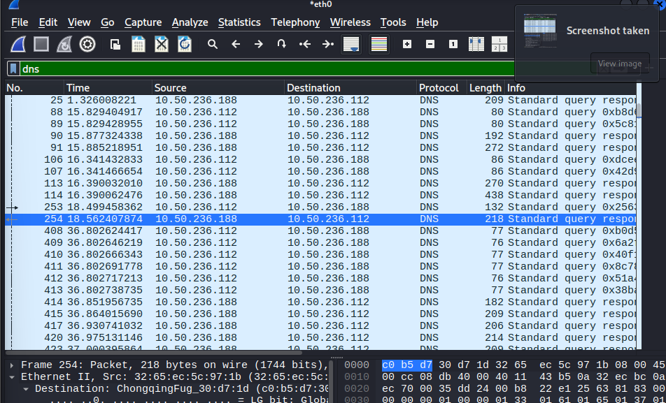
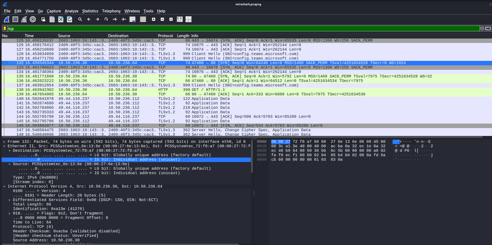
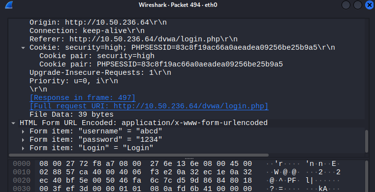

# Network Security Assessment Report

**Prepared by:** Arjun A
**Internship:** Oasis Infobyte Security Analyst Internship (OIBSIP)
**Assessment Date:** 21 October 2026

---

## 1. Scope

| Item | Detail |
|---|---|
| Target machine | Metasploitable2 |
| Assessor machine | Kali Linux |
| Sessions | Two assessment sessions were run on the same target machine under different VirtualBox network configurations: Session A (Host-only Adapter, IP `10.50.236.64`) for Nikto and Wireshark; Session B (Bridged Adapter, IP `192.168.0.230`) for the Nmap scan. Both refer to the same Metasploitable2 VM. |
| Services in scope | All TCP services discovered via Nmap; the DVWA web application on port 80 |
| Time window | 21 October 2026, lab session |
| Authorization | Self-owned lab VMs; no external or production systems in scope |

> **Note on IP addresses:** Because the target VM's network adapter was changed between sessions, it was assigned different IPs by DHCP (`192.168.0.230` under Bridged, `10.50.236.64` under Host-only). Findings below are mapped to the session in which they were observed.

---

## 2. Executive Summary

This assessment evaluated the security posture of a local test server (Metasploitable2) using three industry-standard tools: Nmap for network reconnaissance, Wireshark for traffic analysis, and Nikto for web vulnerability scanning.

The target exposes an extremely large attack surface — **25 open services** were discovered, including legacy and inherently insecure protocols (Telnet, FTP with a known backdoored version, an exposed root bind shell, VNC with no modern authentication, and an IRC daemon with a known backdoor). On the web application layer, Nikto identified a configuration backup file exposing database credentials in plain text, along with an outdated, end-of-life web server. Packet capture confirmed that login credentials are transmitted completely unencrypted over HTTP.

**Overall risk posture: Critical.** Multiple findings — particularly the exposed root bind shell on port 1524, the backdoored FTP service (vsftpd 2.3.4, publicly known to contain a malicious backdoor), and the unencrypted credential exposure — represent immediate, low-effort paths to full system compromise. This is consistent with Metasploitable2's intended purpose as a deliberately vulnerable training target, but the findings below illustrate exactly why each issue would be unacceptable in a production environment.

---

## 3. Phase 1 — Reconnaissance (Nmap)

**Command used:**
```bash
/usr/lib/nmap/nmap --privileged -sV -O -oN nmap_scan_result.txt 192.168.0.230
```

**Host:** `192.168.0.230` — up, latency 0.0014s
**Scan duration:** 66.82 seconds

*Screenshot: 

**Open ports and services (25 found):**

| Port | Service | Version | Risk Note |
|------|---------|---------|-----------|
| 21/tcp | FTP | vsftpd 2.3.4 | **Critical** — this exact version has a known backdoor (CVE-2011-2523) |
| 22/tcp | SSH | OpenSSH 4.7p1 Debian 8ubuntu1 | Outdated; check for known OpenSSH CVEs for this version |
| 23/tcp | Telnet | Linux telnetd | High — unencrypted remote login |
| 25/tcp | SMTP | Postfix smtpd | Medium — verify open relay status |
| 53/tcp | DNS | ISC BIND 9.4.2 | Medium — outdated, known BIND CVEs |
| 80/tcp | HTTP | Apache httpd 2.2.8 (Ubuntu) DAV/2 | High — EOL version, WebDAV enabled |
| 111/tcp | rpcbind | RPC #100000 | Medium — often leveraged for further RPC enumeration |
| 139/tcp | netbios-ssn | Samba smbd 3.X–4.X | High — legacy SMB, historically exploited |
| 445/tcp | netbios-ssn | Samba smbd 3.X–4.X | High — legacy SMB, historically exploited |
| 512/tcp | exec | — | High — unauthenticated remote exec service |
| 513/tcp | login | — | High — rlogin, unencrypted remote login |
| 514/tcp | shell | — | High — rsh, unencrypted remote shell |
| 1099/tcp | java-rmi | GNU Classpath grmiregistry | Medium — RMI registry, potential deserialization risk |
| 1524/tcp | bindshell | **Metasploitable root shell** | **Critical** — unauthenticated root shell exposed directly |
| 2049/tcp | nfs | RPC #100003 | Medium — check export permissions |
| 2121/tcp | FTP | ProFTPD 1.3.1 | High — known vulnerable version |
| 3306/tcp | MySQL | 5.0.51a-3ubuntu5 | High — outdated DB version |
| 5432/tcp | PostgreSQL | 8.3.0–8.3.7 | High — outdated DB version |
| 5900/tcp | VNC | protocol 3.3 | High — weak/legacy auth protocol |
| 6000/tcp | X11 | access denied | Low — port open but access restricted |
| 6667/tcp | IRC | UnrealIRCd | **Critical** — this version has a known backdoor (CVE-2010-2075) |
| 8009/tcp | AJP | Apache JServ Protocol v1.3 | Medium — AJP has known request-smuggling CVEs (Ghostcat-class) |
| 8180/tcp | HTTP | Apache Tomcat/Coyote 1.1 | High — check for default/weak Tomcat manager credentials |

**OS Detection:** Linux 2.6.9 – 2.6.33 (general purpose). MAC vendor: Oracle VirtualBox virtual NIC, confirming a VM target.

---

## 4. Phase 2 — Traffic Analysis (Wireshark)

**Session:** Host-only Adapter, `10.50.236.64` (Kali at `10.50.236.30`)
**Capture:** 1,062 packets total

*Screenshot: 

**HTTP filter (`http`):** 18 HTTP frames identified, including the full DVWA browsing session (`/`, `/dvwa`, `/dvwa/login.php`, CSS/image assets, and the login POST).

*Screenshot: 

**DNS filter (`dns`):** 112 DNS frames captured during the session.

*Screenshot: 

**TCP 3-way handshake** (filter: `tcp.port == 47460 && ip.addr == 10.50.236.64`):

| Step | Frame | Flags | Description |
|------|-------|-------|-------------|
| 1 | 132 | SYN | Client (10.50.236.30) requests connection to server (10.50.236.64:80) |
| 2 | 135 | SYN, ACK | Server acknowledges and sends its own SYN |
| 3 | 136 | ACK | Client acknowledges — connection established |

*Screenshot: 

**Unencrypted sensitive data observed:**
Frame **494** is an HTTP POST to `/dvwa/login.php` on `10.50.236.64`. The request body is transmitted in plain text:
username=abcd
password=1234
Login=Login

Any party able to observe traffic on this network segment could read these credentials directly — no decryption required.

*Screenshot: 

---

## 5. Phase 3 — Web Vulnerability Scan (Nikto)

**Session:** Host-only Adapter, `10.50.236.64:80`

**Command used:**
```bash
nikto -h http://10.50.236.64 -o nikto_scan_results_1.txt
```

*Screenshot: 

**Key findings (full detail in `Task7_NiktoScanning/README.md`):**
- `#wp-config.php#` backup file found — exposes database credentials (Critical)
- Apache/2.2.8 outdated — EOL since 2.2.34 (High)
- `phpinfo.php` exposed — full server config disclosure (High)
- phpMyAdmin directory and docs publicly accessible (High)
- `/doc/`, `/test/`, `/icons/` directories allow indexing/browsing (Medium)
- HTTP TRACE method enabled — XST risk (Medium)
- `mod_negotiation` MultiViews enabled — filename brute-forcing risk (Medium)
- Missing X-Frame-Options / X-Content-Type-Options headers (Low)
- ETag header leaks file inode numbers (Low)

---

## 6. Findings Register

| Finding ID | Description | Severity | Affected Asset | Recommended Fix |
|---|---|---|---|---|
| F-01 | Metasploitable root bind shell exposed, no authentication | Critical | 192.168.0.230:1524 | Remove/disable this service entirely — it should never exist on a real host |
| F-02 | vsftpd 2.3.4 — publicly known backdoored version (CVE-2011-2523) | Critical | 192.168.0.230:21 | Upgrade FTP service immediately; audit for signs of prior compromise |
| F-03 | UnrealIRCd — publicly known backdoored version (CVE-2010-2075) | Critical | 192.168.0.230:6667 | Upgrade or remove IRC service |
| F-04 | `#wp-config.php#` backup file exposes database credentials | Critical | 10.50.236.64 (web root) | Remove backup/editor-leftover files from the web root |
| F-05 | DVWA login transmits credentials in plain text over HTTP | Critical | 10.50.236.64:80 | Enforce HTTPS/TLS for all authentication traffic |
| F-06 | Telnet, rlogin, rsh, rexec enabled — unencrypted remote access | High | 192.168.0.230:23,512,513,514 | Disable; replace with SSH-only remote access |
| F-07 | Legacy Samba (SMB) exposed on 139/445 | High | 192.168.0.230:139,445 | Patch/upgrade Samba or disable if unused |
| F-08 | Apache/2.2.8 end-of-life on web server | High | 10.50.236.64:80 | Upgrade to a supported, patched Apache version |
| F-09 | `phpinfo.php` exposes full server configuration | High | 10.50.236.64:80 | Remove debug/test scripts before deployment |
| F-10 | phpMyAdmin publicly accessible | High | 10.50.236.64:80 | Restrict to internal IPs/VPN; enforce strong auth |
| F-11 | Outdated MySQL (5.0.51a) and PostgreSQL (8.3.x) | High | 192.168.0.230:3306,5432 | Upgrade database versions; restrict external access |
| F-12 | Apache Tomcat 1.1 with possible default manager credentials | High | 192.168.0.230:8180 | Change default credentials or disable manager app; upgrade Tomcat |
| F-13 | HTTP TRACE method enabled (XST risk) | Medium | 10.50.236.64:80 | Disable TRACE in Apache config |
| F-14 | `mod_negotiation` MultiViews enabled | Medium | 10.50.236.64:80 | Disable MultiViews (`Options -MultiViews`) |
| F-15 | `/doc/`, `/test/`, `/icons/` directory indexing enabled | Medium | 10.50.236.64:80 | Disable directory indexing (`Options -Indexes`) |
| F-16 | AJP connector exposed (request-smuggling risk class) | Medium | 192.168.0.230:8009 | Disable AJP connector if unused, or restrict access |
| F-17 | Missing X-Frame-Options / X-Content-Type-Options headers | Low | 10.50.236.64:80 | Add security headers to server config |
| F-18 | ETag headers leak file inode numbers | Low | 10.50.236.64:80 | Disable ETags or exclude inode data (`FileETag None`) |

---

## 7. Remediation Roadmap

| Priority | Finding(s) | Fix Effort | Target Timeline |
|---|---|---|---|
| 1 (Critical) | F-01, F-02, F-03: Remove/patch backdoored services | Easy | Immediate |
| 2 (Critical) | F-04: Remove exposed credentials file | Easy | Immediate |
| 3 (Critical) | F-05: Enforce HTTPS for authentication | Medium | 1 week |
| 4 (High) | F-06, F-07: Disable legacy remote-access protocols | Medium | 1 week |
| 5 (High) | F-08–F-10: Upgrade Apache, remove debug files, restrict phpMyAdmin | Medium | 2 weeks |
| 6 (High) | F-11, F-12: Upgrade/restrict database and Tomcat services | Hard | 3 weeks |
| 7 (Medium) | F-13–F-16: Harden web server config, disable AJP | Easy–Medium | 2–4 weeks |
| 8 (Low) | F-17, F-18: Add security headers, disable ETags | Easy | 1 month |

---

## 8. Conclusion

This assessment found a Critical overall risk posture, driven by multiple unauthenticated/backdoored services (a root bind shell, backdoored FTP and IRC daemons) combined with an exposed credentials file and unencrypted authentication traffic. While expected for a deliberately vulnerable training VM, every finding here maps directly to a real-world misconfiguration class. Remediation should prioritize removing or patching the Critical-severity services first, followed by enforcing encryption for all authentication traffic, before addressing the remaining hardening items in the roadmap above.

---

## Files in this folder
- `network_security_assessment.md` — this report
- `nmap_scan_result.txt` — raw Nmap scan output
- `nikto_scan_results_1.txt` — raw Nikto scan output
- `wireshark_capture.pcap` — exported packet capture
- `screenshots/` — evidence for all three phases
