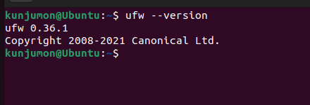
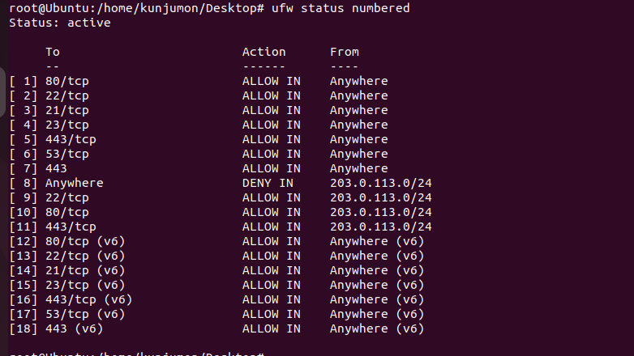
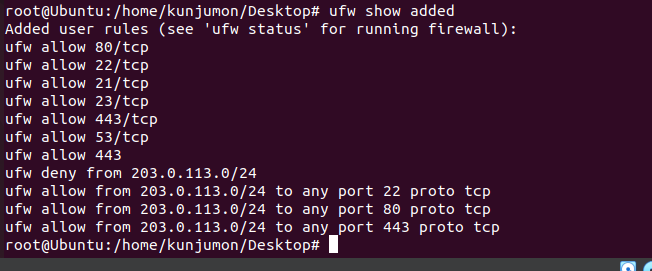
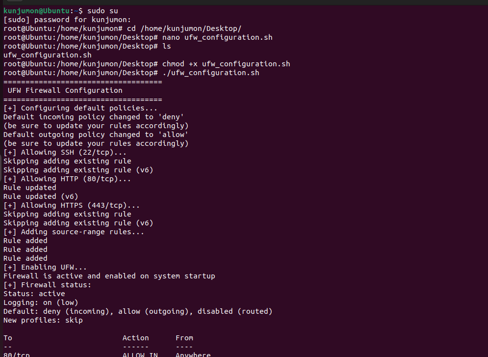

# Task 2: UFW Firewall Configuration

## 1. Objective

The objective of this project is to configure and manage a host-based firewall using UFW (Uncomplicated Firewall) on Ubuntu Linux. The task demonstrates how firewall rules can control network traffic and help protect a system from unauthorised access.

## 2. Tools and Technologies

- Ubuntu Linux
- UFW (Uncomplicated Firewall)
- Bash scripting
- Oracle VirtualBox

## 3. Lab Environment

- **Operating System:** Ubuntu Linux
- **Virtualisation Platform:** Oracle VirtualBox
- **Firewall:** UFW
- **Configuration Script:** `ufw_configuration.sh`

## 4. Tasks Performed

- Checked and enabled the UFW firewall.
- Configured the default incoming policy to deny traffic.
- Configured the default outgoing policy to allow traffic.
- Added firewall rules for SSH, HTTP, and HTTPS.
- Added source IP range rules for `203.0.113.0/24`.
- Enabled verbose firewall status output.
- Verified the active firewall rules.

## 5. Firewall Rules

| Service | Protocol | Port | Purpose |
|---|---|---:|---|
| SSH | TCP | 22 | Remote administration |
| HTTP | TCP | 80 | Web traffic |
| HTTPS | TCP | 443 | Encrypted web traffic |

### Source IP Range

The example source range used in this exercise is `203.0.113.0/24`.

**Note:** This subnet is reserved for documentation and examples. It is not a real public source network for production access control.

The general port rules and source-specific rules are separate. The general rules allow these ports from any source unless additional restrictions are configured.

## 6. Manual Installation & Configuration
Update the package list:

sudo apt update

Install UFW:
```bash
sudo apt install ufw -y
```

Verify installation:
```bash
sudo ufw version
```

Enable UFW
```bash
sudo ufw enable
```

4. Manual Configuration

Configure Default Policies
```bash
sudo ufw default deny incoming
sudo ufw default allow outgoing
```

Allow SSH
```bash
sudo ufw allow 22/tcp
```

Allow HTTP
```bash
sudo ufw allow 80/tcp
```

Allow HTTPS
```bash
sudo ufw allow 443/tcp
```

Configure Source IP Range

The following rules demonstrate source-specific access for an example subnet:

```bash
sudo ufw deny from 203.0.113.0/24
```

Note: 203.0.113.0/24 is reserved for documentation and examples. Replace it with an appropriate authorised lab subnet when testing real source-based access restrictions.

Enable UFW
```bash
sudo ufw enable
```


## 7. Verification Commands

Check firewall status:

```bash
sudo ufw status verbose
```


Display numbered firewall rules:

```bash
sudo ufw status numbered
```



Display rules added through UFW commands:

```bash
sudo ufw show added
```



## 8. Automation Configuration Script

The firewall configuration is automated using `ufw_configuration.sh`.

The script configures default policies, adds the required service rules, enables UFW, and displays the resulting firewall status.

To execute the script on Ubuntu:

```bash
chmod +x ufw_configuration.sh
sudo ./ufw_configuration.sh
```


Ensure you have console access to the Ubuntu VM before changing firewall rules, particularly if administering the machine remotely.


## 9. Results

The firewall configuration was performed as part of a controlled Ubuntu lab exercise. The final status and configured rules should be confirmed against the actual terminal output and screenshots.

## 10. Conclusion

This project provides practical experience in configuring a Linux firewall, managing network access rules, automating configuration using Bash, and verifying firewall status through command-line tools.

## 11. Disclaimer

This project is intended for educational purposes and authorised lab use only. Firewall configurations should be reviewed and tested before deployment in a production environment.

## Internship Information

- **Organisation:** Oasis Infobyte
- **Role:** Security Analyst Intern
- **Task:** Task 2 — UFW Firewall Configuration
- **Repository:** OIBSIP


