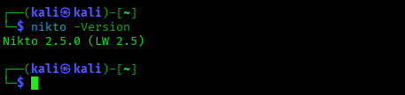
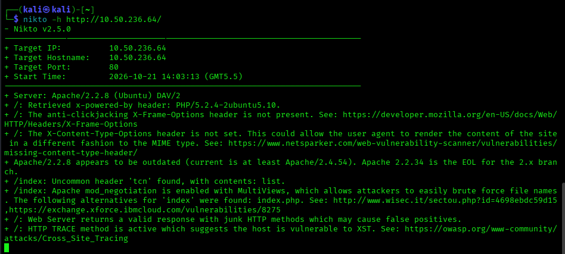
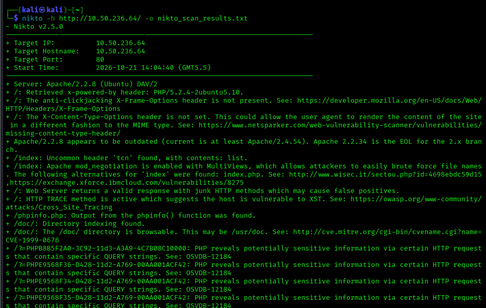

# Task 7 — Vulnerability Scanning with Nikto

## Objective
Use Nikto to perform an automated vulnerability scan on a web server, analyze the results, and document identified security issues with severity ratings and remediation recommendations.

## Tools & Environment
- **Scanner machine:** Kali Linux (VirtualBox)
- **Target:** Metasploitable2 — 10.50.236.64, port 80
- Both VMs connected via a shared VirtualBox NAT Network / Host-only Adapter

## What is Nikto?
Nikto is an open-source web server scanner that checks for thousands of known vulnerabilities, outdated software versions, dangerous files, and misconfigurations in web servers and applications.

## Nikto vs Nmap
Nmap discovers hosts, open ports, and running services across a network. Nikto goes one layer deeper on a single web server — it inspects the actual web application for known vulnerabilities, outdated software, and misconfigured files. Nmap answers "what's running?"; Nikto answers "is what's running vulnerable?"

## Nikto's Limitations (Noisy Scanner)
Nikto is considered a "noisy" scanner because it sends a very large number of requests in a short time, with no attempt to evade detection or logging. This makes it fast and thorough for authorized testing, but it would immediately trigger alerts on any monitored production system — so it should never be run against systems without explicit permission.

## Installation
Nikto comes pre-installed on Kali Linux. Verified with:
```bash
nikto -Version
```


## Scans Performed

**1. Basic scan**
```bash
nikto -h http://10.50.236.64
```


**2. Scan with output saved to file**
```bash
nikto -h http://10.50.236.64 -o nikto_scan_results.txt
```


**3. SSL/HTTPS scan**
*(Metasploitable2's Apache on this host serves HTTP only on port 80 — no HTTPS service was found, so the `-ssl` flag was not applicable here. Noted for completeness.)*

## Findings

### Critical
| Finding | Why It's a Risk | Recommended Fix |
|---|---|---|
| `#wp-config.php#` file found, containing credentials | A leftover/backup WordPress config file exposes database credentials directly to anyone who requests it | Remove backup/editor-leftover files (`.bak`, `~`, `#file#`) from the web root; never store credentials in web-accessible files |

### High
| Finding | Why It's a Risk | Recommended Fix |
|---|---|---|
| Apache/2.2.8 outdated (EOL — current is 2.4.54+) | No longer receives security patches; vulnerable to any CVE discovered after EOL | Upgrade Apache to a supported, actively patched version |
| `phpinfo.php` exposed | Reveals full PHP configuration, server paths, loaded modules, and environment variables — a roadmap for further attacks | Delete `phpinfo.php` and any other debug/test scripts before deployment |
| phpMyAdmin exposed (`/phpMyAdmin/`, changelog, README, Documentation) | Database admin panel reachable publicly; if default/weak credentials exist, full DB compromise is possible | Restrict phpMyAdmin to internal IPs/VPN, enforce strong auth, or remove it from production |

### Medium
| Finding | Why It's a Risk | Recommended Fix |
|---|---|---|
| `mod_negotiation` MultiViews enabled | Lets attackers brute-force filenames by requesting partial names (e.g., `index` resolves `index.php`) | Disable MultiViews in Apache config (`Options -MultiViews`) |
| HTTP TRACE method enabled | Vulnerable to Cross-Site Tracing (XST), which can be used to steal cookies/headers via XSS | Disable TRACE method (`TraceEnable off` in Apache config) |
| `/doc/` directory indexing + browsable (CVE-1999-0678) | Exposes file listing of the doc directory, potentially leaking sensitive files | Disable directory indexing (`Options -Indexes`); restrict or remove `/doc/` |
| `/test/` directory indexing | Exposes test directory contents publicly | Disable indexing; remove test directories from production |

### Low
| Finding | Why It's a Risk | Recommended Fix |
|---|---|---|
| X-Frame-Options header missing | Site can be embedded in an iframe on a malicious page (clickjacking) | Add `X-Frame-Options: SAMEORIGIN` header |
| X-Content-Type-Options header missing | Browser may MIME-sniff content, enabling certain content-injection attacks | Add `X-Content-Type-Options: nosniff` header |
| ETag header leaks inode number | Minor internal server information disclosure | Disable ETags or configure them to exclude inode data (`FileETag None`) |
| `/icons/` directory indexing + default README found | Default Apache files left in place; minor info disclosure | Remove default Apache icons/README; disable indexing |
| Junk HTTP methods return valid response | Can cause false positives in automated scanning/testing | Restrict allowed HTTP methods at the server/application level |

### Informational
| Finding | Why It's a Risk | Recommended Fix |
|---|---|---|
| X-Powered-By header reveals PHP/5.2.4-2ubuntu5.10 | Confirms exact PHP version, aiding attackers in targeting known PHP CVEs | Suppress version banners (`expose_php = Off` in php.ini) |
| Uncommon `tcn` header found | Minor fingerprinting detail, low impact alone | No action required unless combined with other findings |
| PHP query-string info disclosure (`PHPB8B5F2A0...`, `PHPE9568F3x...`) — 4 instances | Confirms PHP version/build via special query strings (OSVDB-12184) | Upgrade PHP to a current, supported version |

## Files in this folder
- `nikto_scan_results.txt` — raw scan output
- `screenshots/` — terminal output and results screenshots

